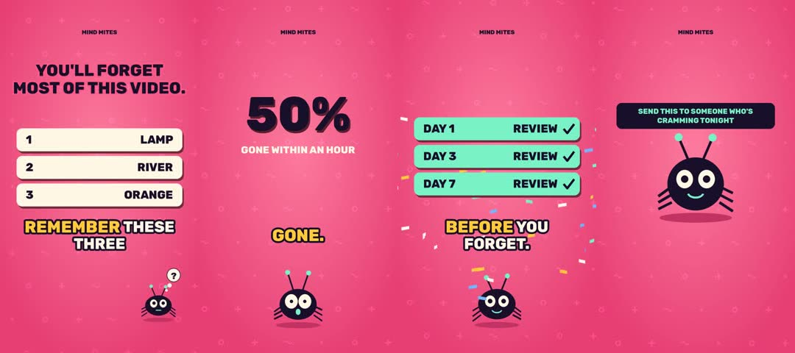
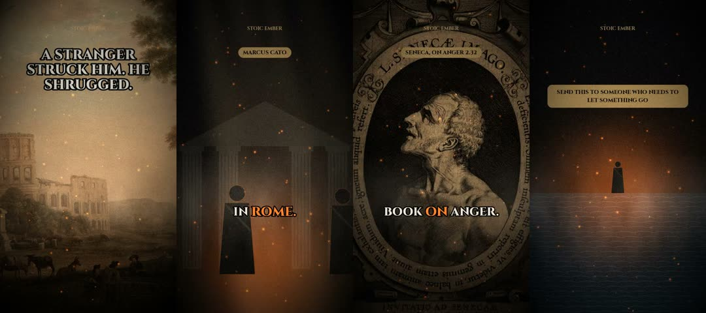
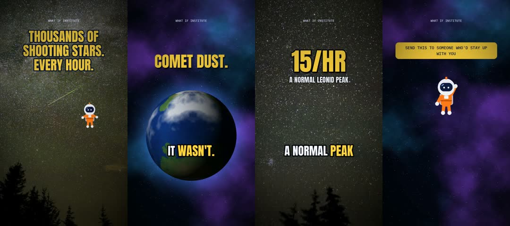

# Daily report 2026-11-16: 5 problems to fix

Generated 2026-11-16 17:09 UTC, after the daily publish.

## 1. Needs fixing

- **Render videos**: [Render videos: Render videos](https://github.com/krystofstudio7/shorts-studio/actions/runs/43908839970) failure (failed step: Remember what was uploaded).  
  _Fix:_ Open the run log for the error.
- **Render videos**: [Render videos: Render videos](https://github.com/krystofstudio7/shorts-studio/actions/runs/43904793373) failure (failed step: Fail if an episode did not render or a Reels upload failed).  
  _Fix:_ Open the run log for the error.
- **What If Institute**: `what-if-010-leonid-storm` has no Instagram Reel.  
  _Fix:_ Run **Render videos** manually with episodes `episodes/what-if-institute/what-if-010-leonid-storm.yaml` and upload `public`; platforms that already have it are skipped.
- **Stoic Ember**: `story-010-cato-baths` has no Instagram Reel.  
  _Fix:_ Run **Render videos** manually with episodes `episodes/stoic-ember/story-010-cato-baths.yaml` and upload `public`; platforms that already have it are skipped.
- **Mind Mites**: `brain-test-010` has no Instagram Reel.  
  _Fix:_ Run **Render videos** manually with episodes `episodes/mind-mites/brain-test-010.yaml` and upload `public`; platforms that already have it are skipped.

## Heads-up

- **Facebook**: Reel insights failed for 21 video(s): `GET https://graph.facebook.com/v23.0/2198361498223810/video_insights -> 400: (#100) The value must be a valid insights metric`

## 2. Today's videos

### Mind Mites: Brain Test #10: How fast you forget 🐛

hook · 30 % · 60 % · ending

- 45 s
- spoken hook 47/100 "Quick test. Remember these three words. Lamp. River. Orange."
- on-screen hook "You'll forget most of this video."
- no loop
- [YouTube](https://youtube.com/shorts/4DxnTOuALFg) · [Facebook](https://www.facebook.com/reel/2142083986398753)
- To improve next time: spoken hook scores 47/100 (weak). Weakest: stakes, 0 tension marker(s) - nothing is at stake in this line.; No loop: the last line shares no word with the first, so the end does not invite a replay.

### Stoic Ember: A stranger hit him in public. His reply was perfect.

hook · 30 % · 60 % · ending

- 41 s
- spoken hook 37/100 "A stranger hit him in public. He didn't hit back."
- on-screen hook "A stranger struck him. He shrugged."
- no loop
- [YouTube](https://youtube.com/shorts/mmKqMI7SHVQ) · [Facebook](https://www.facebook.com/reel/1031365546649112)
- To improve next time: spoken hook scores 37/100 (weak). Weakest: specificity, 0 concrete marker(s) - no number, no name, nothing checkable.; The first spoken line ends at ~3.8s (10 words). Hooks that land inside 3s hold more viewers; aim for 7 words or fewer.; No loop: the last line shares no word with the first, so the end does not invite a replay.

### What If Institute: What if the 1833 meteor storm happened tonight? ☄️

hook · 30 % · 60 % · ending

- 52 s
- spoken hook 43/100 "What if the sky did tonight what it did in November 1833?"
- on-screen hook "Thousands of shooting stars. Every hour."
- no loop
- [YouTube](https://youtube.com/shorts/3108M64cKQ4) · [Facebook](https://www.facebook.com/reel/2198361498223810)
- To improve next time: spoken hook scores 43/100 (weak). Weakest: stakes, 0 tension marker(s) - nothing is at stake in this line.; The first spoken line ends at ~4.0s (12 words). Hooks that land inside 3s hold more viewers; aim for 8 words or fewer.; No loop: the last line shares no word with the first, so the end does not invite a replay.

## 3. Performance

### Views gained in the last 24 h (vs 2026-11-15)

| channel | YouTube | Facebook | Instagram | YouTube subscribers |
| --- | --- | --- | --- | --- |
| What If Institute | +16 (3,513 total) | – | +0 (901 total) | 9 (+0) |
| Stoic Ember | +1 (2,059 total) | – | +0 (418 total) | 8 (+0) |
| Mind Mites | +0 (2,275 total) | – | +0 (763 total) | 2 (+0) |

### Top movers (views gained, all platforms)

| video | +views | YouTube | Facebook | Instagram |
| --- | --- | --- | --- | --- |
| what-if-institute/what-if-010-leonid-storm | +15 | 15 | – | – |
| what-if-institute/what-if-008-moon-radiation | +1 | 282 | – | 139 |
| stoic-ember/story-010-cato-baths | +1 | 1 | – | – |

The full ranking with what the best videos have in common is in the weekly [performance report](https://github.com/krystofstudio7/shorts-studio/blob/main/reports/performance.md), every Monday.

