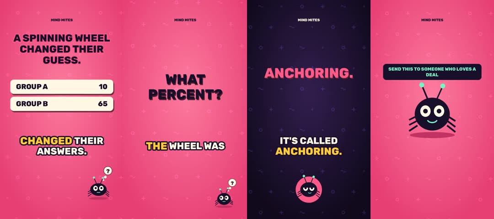
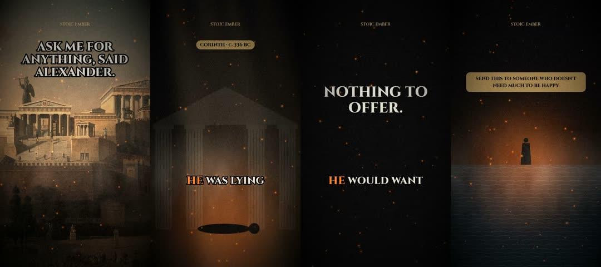
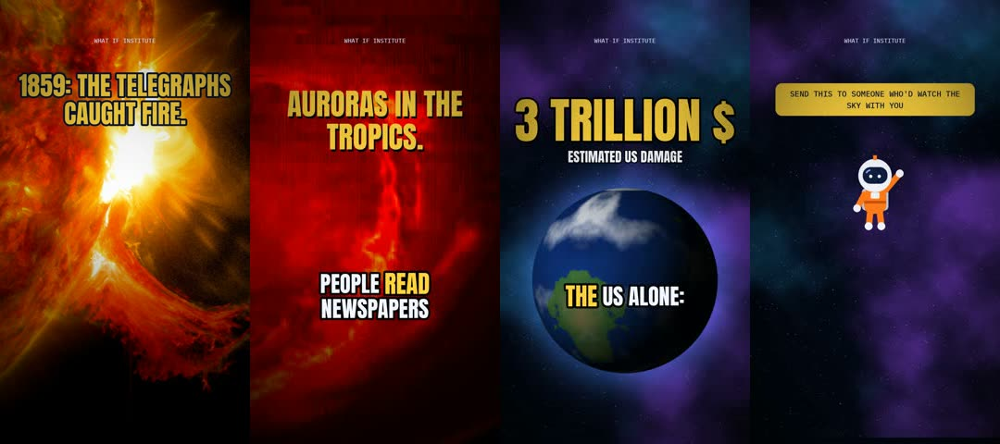

# Daily report 2026-11-17: 5 problems to fix

Generated 2026-11-17 15:58 UTC, after the daily publish.

## 1. Needs fixing

- **Instagram debug (temporary)**: [Instagram debug (temporary): Instagram debug: test variants of a real render](https://github.com/krystofstudio7/shorts-studio/actions/runs/44080410483) failure (failed step: Run python tools/ig_debug.py).  
  _Fix:_ Open the run log for the error.
- **Instagram debug (temporary)**: [Instagram debug (temporary): Instagram debug: test captions and our own video](https://github.com/krystofstudio7/shorts-studio/actions/runs/44079826815) failure (failed step: Run python tools/ig_debug.py).  
  _Fix:_ Open the run log for the error.
- **Render videos**: [Render videos: Render videos](https://github.com/krystofstudio7/shorts-studio/actions/runs/43910922770) failure (failed step: Fail if an episode did not render or a Reels upload failed).  
  _Fix:_ Open the run log for the error.
- **Render videos**: [Render videos: Render videos](https://github.com/krystofstudio7/shorts-studio/actions/runs/43908839970) failure (failed step: Remember what was uploaded).  
  _Fix:_ Open the run log for the error.
- **Render videos**: [Render videos: Render videos](https://github.com/krystofstudio7/shorts-studio/actions/runs/43904793373) failure (failed step: Fail if an episode did not render or a Reels upload failed).  
  _Fix:_ Open the run log for the error.

## Heads-up

- **Facebook**: Reel insights failed for 24 video(s): `GET https://graph.facebook.com/v23.0/1649171036203716/video_insights -> 400: (#100) The value must be a valid insights metric`

## 2. Today's videos

### Mind Mites: Brain Test #11: A random number changed their answer 🐛

hook · 30 % · 60 % · ending

- 48 s
- spoken hook 52/100 "A random wheel changed their answers. They never noticed."
- on-screen hook "A spinning wheel changed their guess."
- no loop
- [YouTube](https://youtube.com/shorts/X8CnNLnTvRk) · [Facebook](https://www.facebook.com/reel/4412923079020152) · Instagram
- To improve next time: No loop: the last line shares no word with the first, so the end does not invite a replay.; Estimated length 46s is outside the 30-45s target.

### Stoic Ember: The most powerful man alive offered him anything.

hook · 30 % · 60 % · ending

- 43 s
- spoken hook 41/100 "Alexander offered him anything. He didn't want it."
- on-screen hook "Ask me for anything, said Alexander."
- no loop
- [YouTube](https://youtube.com/shorts/q74tYexncWw) · [Facebook](https://www.facebook.com/reel/2608678562969379) · Instagram
- To improve next time: spoken hook scores 41/100 (weak). Weakest: specificity, 0 concrete marker(s) - no number, no name, nothing checkable.; The first spoken line ends at ~3.0s (8 words). Hooks that land inside 3s hold more viewers; aim for 7 words or fewer.; No loop: the last line shares no word with the first, so the end does not invite a replay.

### What If Institute: What if the biggest solar storm ever hit today? ☀️

hook · 30 % · 60 % · ending

- 57 s
- spoken hook 30/100 "What if the biggest solar storm ever recorded hit us today?"
- on-screen hook "1859: the telegraphs caught fire."
- no loop
- [YouTube](https://youtube.com/shorts/yGQ7RlfYofc) · [Facebook](https://www.facebook.com/reel/1649171036203716) · Instagram
- To improve next time: spoken hook scores 30/100 (weak). Weakest: specificity, 0 concrete marker(s) - no number, no name, nothing checkable.; The first spoken line ends at ~3.7s (11 words). Hooks that land inside 3s hold more viewers; aim for 8 words or fewer.; No loop: the last line shares no word with the first, so the end does not invite a replay.

## 3. Performance

### Views gained in the last 24 h (vs 2026-11-16)

| channel | YouTube | Facebook | Instagram | YouTube subscribers |
| --- | --- | --- | --- | --- |
| What If Institute | +164 (3,677 total) | – | +124 (1,025 total) | 9 (+0) |
| Stoic Ember | +13 (2,072 total) | – | +19 (437 total) | 8 (+0) |
| Mind Mites | +73 (2,348 total) | – | +142 (905 total) | 2 (+0) |

### Top movers (views gained, all platforms)

| video | +views | YouTube | Facebook | Instagram |
| --- | --- | --- | --- | --- |
| what-if-institute/what-if-010-leonid-storm | +288 | 179 | – | 124 |
| mind-mites/brain-test-010 | +214 | 72 | – | 142 |
| stoic-ember/story-010-cato-baths | +32 | 14 | – | 19 |
| mind-mites/brain-test-008 | +1 | 1,039 | – | 141 |

### Yesterday's uploads after their first day

| video | YouTube views | x median | % viewed | Facebook | Instagram | x median | likes+comments |
| --- | --- | --- | --- | --- | --- | --- | --- |
| Mind Mites: brain-test-010 | 72 | 0.75 |  | – | 142 | 1.09 | 1 |
| Stoic Ember: story-010-cato-baths | 14 | 0.15 |  | – | 19 | 0.37 | 1 |
| What If Institute: what-if-010-leonid-storm | 179 | 0.63 |  | – | 124 | 0.89 | 3 |

x median: views divided by that channel's median, so 2.0 means twice a normal video for the channel.

The full ranking with what the best videos have in common is in the weekly [performance report](../../performance.md), every Monday.

