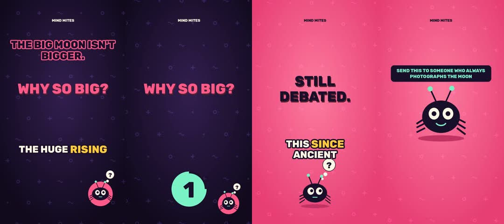
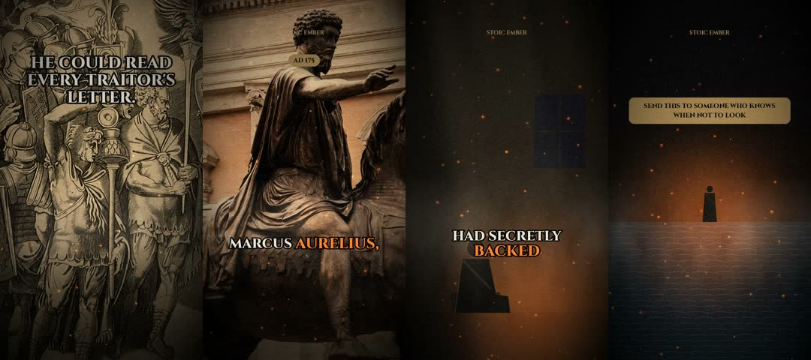
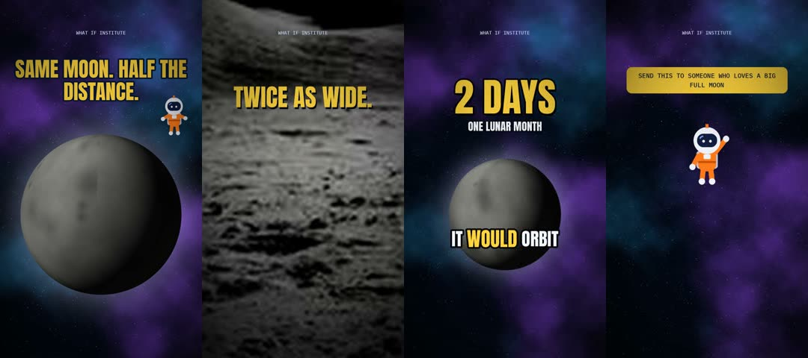

# Daily report 2026-11-18: all good

Generated 2026-11-18 16:14 UTC, after the daily publish.

## 1. Needs fixing

Nothing. Every channel published and every check passed.

## Heads-up

- **Facebook**: Reel insights failed for 27 video(s): `GET https://graph.facebook.com/v23.0/1359816359453163/video_insights -> 400: (#100) The value must be a valid insights metric`

## 2. Today's videos

### Mind Mites: Brain Test #12: The giant Moon is an illusion 🌕

hook · 30 % · 60 % · ending

- 46 s
- spoken hook 65/100 "The huge rising Moon? Your brain is lying."
- on-screen hook "The big Moon isn't bigger."
- loops back to the hook
- [YouTube](https://youtube.com/shorts/QgB-DQcTeKY) · [Facebook](https://www.facebook.com/reel/1148880771205444) · Instagram

### Stoic Ember: He found the traitors' letters. He burned them unread.

hook · 30 % · 60 % · ending

- 39 s
- spoken hook 41/100 "He held his traitors' letters. He never read them."
- on-screen hook "He could read every traitor's letter."
- no loop
- [YouTube](https://youtube.com/shorts/2O-1H0GKGdE) · [Facebook](https://www.facebook.com/reel/1455517486686606) · Instagram
- To improve next time: spoken hook scores 41/100 (weak). Weakest: specificity, 0 concrete marker(s) - no number, no name, nothing checkable.; The first spoken line ends at ~3.4s (9 words). Hooks that land inside 3s hold more viewers; aim for 7 words or fewer.; No loop: the last line shares no word with the first, so the end does not invite a replay.

### What If Institute: What if the Moon were twice as close? 🌕

hook · 30 % · 60 % · ending

- 43 s
- spoken hook 47/100 "What if the Moon were twice as close?"
- on-screen hook "Same Moon. Half the distance."
- loops back to the hook
- [YouTube](https://youtube.com/shorts/ZJIN-XlJMaE) · [Facebook](https://www.facebook.com/reel/1359816359453163) · Instagram
- To improve next time: spoken hook scores 47/100 (weak). Weakest: stakes, 0 tension marker(s) - nothing is at stake in this line.

## 3. Performance

### Views gained in the last 24 h (vs 2026-11-17)

| channel | YouTube | Facebook | Instagram | YouTube subscribers |
| --- | --- | --- | --- | --- |
| What If Institute | +94 (3,771 total) | – | +118 (1,143 total) | 9 (+0) |
| Stoic Ember | +39 (2,111 total) | – | +10 (447 total) | 8 (+0) |
| Mind Mites | +34 (2,382 total) | – | +3 (908 total) | 2 (+0) |

### Top movers (views gained, all platforms)

| video | +views | YouTube | Facebook | Instagram |
| --- | --- | --- | --- | --- |
| what-if-institute/what-if-011-carrington-flare | +196 | 79 | – | 117 |
| stoic-ember/story-011-diogenes-alexander | +41 | 39 | – | 2 |
| mind-mites/brain-test-011 | +33 | 32 | – | 1 |
| what-if-institute/what-if-010-leonid-storm | +16 | 194 | – | 125 |
| stoic-ember/story-010-cato-baths | +8 | 14 | – | 27 |

### Yesterday's uploads after their first day

| video | YouTube views | x median | % viewed | Facebook | Instagram | x median | likes+comments |
| --- | --- | --- | --- | --- | --- | --- | --- |
| Mind Mites: brain-test-011 | 32 | 0.34 |  | – | 1 | 0.01 | 0 |
| Stoic Ember: story-011-diogenes-alexander | 39 | 0.44 |  | – | 2 | 0.07 | 2 |
| What If Institute: what-if-011-carrington-flare | 79 | 0.33 |  | – | 117 | 0.89 | 4 |

x median: views divided by that channel's median, so 2.0 means twice a normal video for the channel.

The full ranking with what the best videos have in common is in the weekly [performance report](../../performance.md), every Monday.

