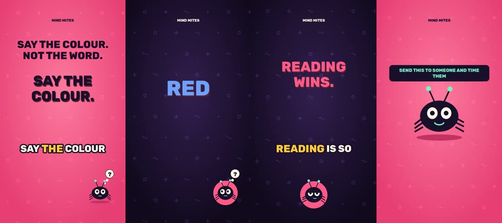
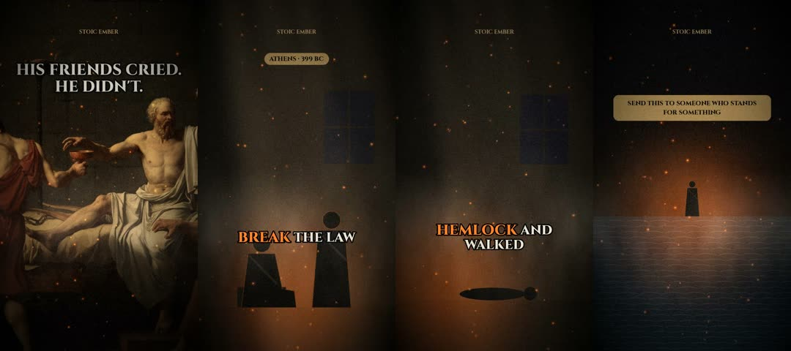
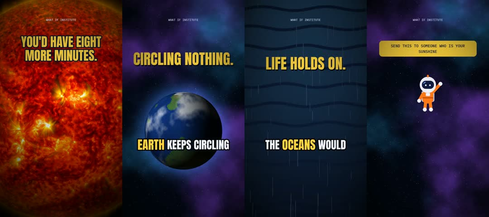

# Daily report 2026-11-19: all good

Generated 2026-11-19 16:01 UTC, after the daily publish.

## 1. Needs fixing

Nothing. Every channel published and every check passed.

## Heads-up

- **Facebook**: Reel insights failed for 30 video(s): `GET https://graph.facebook.com/v23.0/2236520746927658/video_insights -> 400: (#100) The value must be a valid insights metric`

## 2. Today's videos

### Mind Mites: Brain Test #13: Say the colour, not the word 🎨

hook · 30 % · 60 % · ending

- 27 s
- spoken hook 53/100 "Easy game. Say the colour of the word, not the word itself. Ready?"
- on-screen hook "Say the colour. Not the word."
- no loop
- [YouTube](https://youtube.com/shorts/92zhREvo6x8) · [Facebook](https://www.facebook.com/reel/29158507527147046) · Instagram
- To improve next time: The first spoken line ends at ~4.0s (13 words). Hooks that land inside 3s hold more viewers; aim for 9 words or fewer.; Lines 2-4 have no number or name. Put something checkable in one.; No loop: the last line shares no word with the first, so the end does not invite a replay.

### Stoic Ember: Sentenced to death, he comforted his friends.

hook · 30 % · 60 % · ending

- 42 s
- spoken hook 41/100 "He could have escaped. He didn't."
- on-screen hook "His friends cried. He didn't."
- no loop
- [YouTube](https://youtube.com/shorts/fU8RL7jE91I) · [Facebook](https://www.facebook.com/reel/2306369633490028) · Instagram
- To improve next time: spoken hook scores 41/100 (weak). Weakest: specificity, 0 concrete marker(s) - no number, no name, nothing checkable.; No loop: the last line shares no word with the first, so the end does not invite a replay.; Estimated length 49s is outside the 30-45s target.

### What If Institute: What if the Sun disappeared right now? 🌑

hook · 30 % · 60 % · ending

- 43 s
- spoken hook 39/100 "What if the Sun disappeared right now?"
- on-screen hook "You'd have eight more minutes."
- no loop
- [YouTube](https://youtube.com/shorts/4woV0UMrP_c) · [Facebook](https://www.facebook.com/reel/2236520746927658) · Instagram
- To improve next time: spoken hook scores 39/100 (weak). Weakest: stakes, 0 tension marker(s) - nothing is at stake in this line.; No loop: the last line shares no word with the first, so the end does not invite a replay.

## 3. Performance

### Views gained in the last 24 h (vs 2026-11-18)

| channel | YouTube | Facebook | Instagram | YouTube subscribers |
| --- | --- | --- | --- | --- |
| What If Institute | +298 (4,069 total) | – | +164 (1,307 total) | 9 (+0) |
| Stoic Ember | +14 (2,125 total) | – | +125 (572 total) | 8 (+0) |
| Mind Mites | +14 (2,396 total) | – | +1 (909 total) | 2 (+0) |

### Top movers (views gained, all platforms)

| video | +views | YouTube | Facebook | Instagram |
| --- | --- | --- | --- | --- |
| what-if-institute/what-if-012-moon-twice-as-close | +431 | 267 | – | 164 |
| stoic-ember/story-012-burned-letters | +133 | 8 | – | 125 |
| what-if-institute/what-if-011-carrington-flare | +31 | 110 | – | 117 |
| mind-mites/brain-test-012 | +14 | 13 | – | 1 |
| stoic-ember/story-011-diogenes-alexander | +6 | 45 | – | 2 |

### Yesterday's uploads after their first day

| video | YouTube views | x median | % viewed | Facebook | Instagram | x median | likes+comments |
| --- | --- | --- | --- | --- | --- | --- | --- |
| Mind Mites: brain-test-012 | 13 | 0.14 |  | – | 1 | 0.01 | 0 |
| Stoic Ember: story-012-burned-letters | 8 | 0.09 |  | – | 125 | 2.27 | 2 |
| What If Institute: what-if-012-moon-twice-as-close | 267 | 1.0 |  | – | 164 | 1.18 | 4 |

x median: views divided by that channel's median, so 2.0 means twice a normal video for the channel.

The full ranking with what the best videos have in common is in the weekly [performance report](../../performance.md), every Monday.

