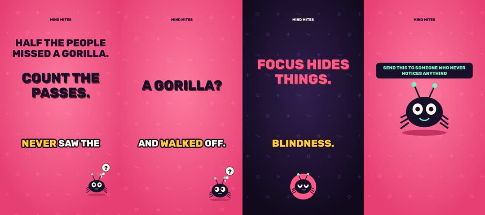
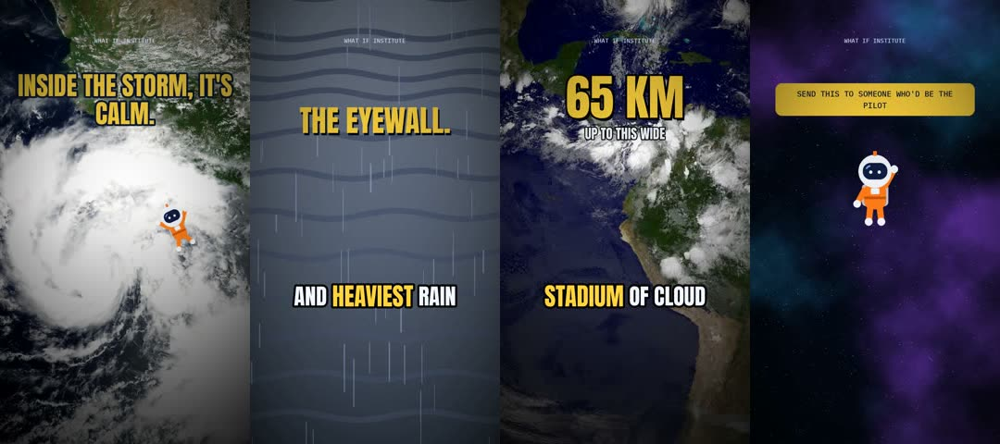

# Daily report 2026-11-20: all good

Generated 2026-11-20 15:58 UTC, after the daily publish.

## 1. Needs fixing

Nothing. Every channel published and every check passed.

## Heads-up

- **Stoic Ember**: only 3 episode(s) left in the queue.
- **Mind Mites**: only 3 episode(s) left in the queue.
- **Facebook**: Reel insights failed for 33 video(s): `GET https://graph.facebook.com/v23.0/1160822853009174/video_insights -> 400: (#100) The value must be a valid insights metric`

## 2. Today's videos

### Mind Mites: Brain Test #14: Half the people missed a gorilla 🦍

hook · 30 % · 60 % · ending

- 40 s
- spoken hook 60/100 "Half the people never saw the gorilla."
- on-screen hook "Half the people missed a gorilla."
- loops back to the hook
- [YouTube](https://youtube.com/shorts/5MQWk1X36R8) · [Facebook](https://www.facebook.com/reel/1789622975470294) · Instagram

### Stoic Ember: Exiled to hard labour, he kept teaching.

hook · 30 % · 60 % · ending

- 39 s
- spoken hook 51/100 "AD 65. Nero exiles the philosopher Musonius Rufus."
- on-screen hook "Nero sent him to dig. He taught."
- no loop
- [YouTube](https://youtube.com/shorts/mhTi3IVZVHw) · [Facebook](https://www.facebook.com/reel/1022966384179899) · Instagram
- To improve next time: The first spoken line ends at ~3.0s (8 words). Hooks that land inside 3s hold more viewers; aim for 7 words or fewer.; No loop: the last line shares no word with the first, so the end does not invite a replay.

### What If Institute: What if you flew into the eye of a hurricane? 🌀

hook · 30 % · 60 % · ending

- 44 s
- spoken hook 38/100 "What if you flew straight into a hurricane?"
- on-screen hook "Inside the storm, it's calm."
- no loop
- [YouTube](https://youtube.com/shorts/GC6WijlJtS4) · [Facebook](https://www.facebook.com/reel/1160822853009174) · Instagram
- To improve next time: spoken hook scores 38/100 (weak). Weakest: specificity, 0 concrete marker(s) - no number, no name, nothing checkable.; No loop: the last line shares no word with the first, so the end does not invite a replay.

## 3. Performance

### Views gained in the last 24 h (vs 2026-11-19)

| channel | YouTube | Facebook | Instagram | YouTube subscribers |
| --- | --- | --- | --- | --- |
| What If Institute | +154 (4,223 total) | – | +135 (1,442 total) | 9 (+0) |
| Stoic Ember | +46 (2,171 total) | – | +7 (579 total) | 9 (+1) |
| Mind Mites | +1,117 (3,513 total) | – | +128 (1,037 total) | 3 (+1) |

### Top movers (views gained, all platforms)

| video | +views | YouTube | Facebook | Instagram |
| --- | --- | --- | --- | --- |
| mind-mites/brain-test-013 | +1,197 | 1,069 | – | 128 |
| what-if-institute/what-if-013-sun-disappears | +231 | 96 | – | 135 |
| what-if-institute/what-if-012-moon-twice-as-close | +53 | 320 | – | 164 |
| stoic-ember/story-013-socrates-cup | +53 | 46 | – | 7 |
| mind-mites/brain-test-012 | +39 | 52 | – | 1 |

### Yesterday's uploads after their first day

| video | YouTube views | x median | % viewed | Facebook | Instagram | x median | likes+comments |
| --- | --- | --- | --- | --- | --- | --- | --- |
| Mind Mites: brain-test-013 | 1069 | 11.19 |  | – | 128 | 1.0 | 5 |
| Stoic Ember: story-013-socrates-cup | 46 | 0.67 |  | – | 7 | 0.26 | 4 |
| What If Institute: what-if-013-sun-disappears | 96 | 0.4 |  | – | 135 | 0.99 | 2 |

x median: views divided by that channel's median, so 2.0 means twice a normal video for the channel.

The full ranking with what the best videos have in common is in the weekly [performance report](https://github.com/krystofstudio7/shorts-studio/blob/main/reports/performance.md), every Monday.

