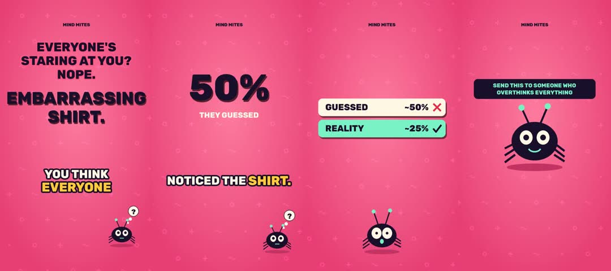
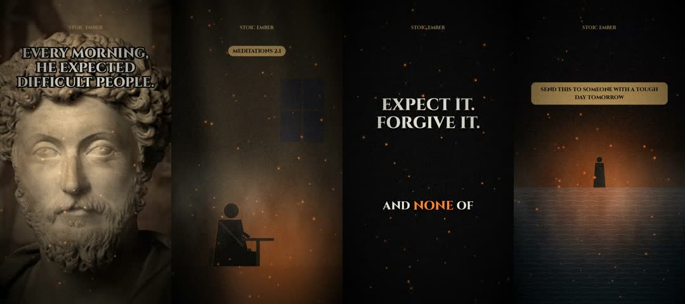
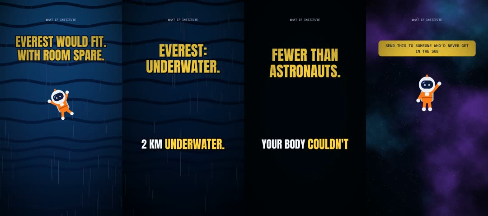

# Daily report 2026-11-21: all good

Generated 2026-11-21 15:46 UTC, after the daily publish.

## 1. Needs fixing

Nothing. Every channel published and every check passed.

## Heads-up

- **What If Institute**: only 3 episode(s) left in the queue.
- **Stoic Ember**: only 2 episode(s) left in the queue.
- **Mind Mites**: only 2 episode(s) left in the queue.
- **Facebook**: Reel insights failed for 36 video(s): `GET https://graph.facebook.com/v23.0/1123637133641308/video_insights -> 400: (#100) The value must be a valid insights metric`

## 2. Today's videos

### Mind Mites: Brain Test #15: Nobody noticed the embarrassing T-shirt 👕

hook · 30 % · 60 % · ending

- 35 s
- spoken hook 62/100 "You think everyone noticed. Only a few did."
- on-screen hook "Everyone's staring at you? Nope."
- no loop
- [YouTube](https://youtube.com/shorts/yAf36htyXcM) · [Facebook](https://www.facebook.com/reel/1440262884427623) · Instagram
- To improve next time: No loop: the last line shares no word with the first, so the end does not invite a replay.

### Stoic Ember: The emperor's morning routine was 2 sentences.

hook · 30 % · 60 % · ending

- 43 s
- spoken hook 56/100 "Every morning, Rome's emperor expected the worst people."
- on-screen hook "Every morning, he expected difficult people."
- no loop
- [YouTube](https://youtube.com/shorts/aNoOoecI1kc) · [Facebook](https://www.facebook.com/reel/1685284366566938) · Instagram
- To improve next time: The first spoken line ends at ~3.0s (8 words). Hooks that land inside 3s hold more viewers; aim for 7 words or fewer.; No loop: the last line shares no word with the first, so the end does not invite a replay.; Estimated length 47s is outside the 30-45s target.

### What If Institute: What if you dove to the bottom of the ocean? 🌊

hook · 30 % · 60 % · ending

- 43 s
- spoken hook 38/100 "What if you dove to the deepest point in the ocean?"
- on-screen hook "Everest would fit. With room spare."
- no loop
- [YouTube](https://youtube.com/shorts/QQEict6MBhI) · [Facebook](https://www.facebook.com/reel/1123637133641308) · Instagram
- To improve next time: spoken hook scores 38/100 (weak). Weakest: specificity, 0 concrete marker(s) - no number, no name, nothing checkable.; The first spoken line ends at ~3.7s (11 words). Hooks that land inside 3s hold more viewers; aim for 8 words or fewer.; No loop: the last line shares no word with the first, so the end does not invite a replay.

## 3. Performance

### Views gained in the last 24 h (vs 2026-11-20)

| channel | YouTube | Facebook | Instagram | YouTube subscribers |
| --- | --- | --- | --- | --- |
| What If Institute | +358 (4,581 total) | – | +133 (1,575 total) | 11 (+2) |
| Stoic Ember | +241 (2,412 total) | – | +12 (591 total) | 10 (+1) |
| Mind Mites | +150 (3,663 total) | – | +121 (1,158 total) | 3 (+0) |

### Top movers (views gained, all platforms)

| video | +views | YouTube | Facebook | Instagram |
| --- | --- | --- | --- | --- |
| what-if-institute/what-if-014-hurricane-eye | +264 | 131 | – | 133 |
| stoic-ember/story-014-musonius-canal | +249 | 237 | – | 12 |
| what-if-institute/what-if-013-sun-disappears | +221 | 317 | – | 135 |
| mind-mites/brain-test-014 | +216 | 95 | – | 121 |
| mind-mites/brain-test-013 | +48 | 1,117 | – | 128 |

### Yesterday's uploads after their first day

| video | YouTube views | x median | % viewed | Facebook | Instagram | x median | likes+comments |
| --- | --- | --- | --- | --- | --- | --- | --- |
| Mind Mites: brain-test-014 | 95 | 1.0 |  | – | 121 | 0.97 | 1 |
| Stoic Ember: story-014-musonius-canal | 237 | 2.79 |  | – | 12 | 0.62 | 5 |
| What If Institute: what-if-014-hurricane-eye | 131 | 0.46 |  | – | 133 | 0.99 | 3 |

x median: views divided by that channel's median, so 2.0 means twice a normal video for the channel.

The full ranking with what the best videos have in common is in the weekly [performance report](../../performance.md), every Monday.

