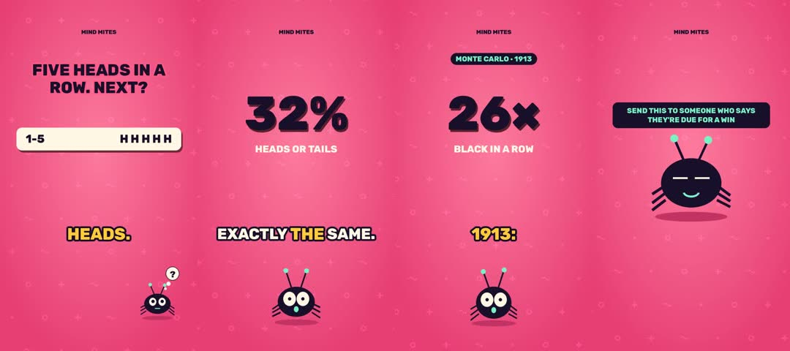
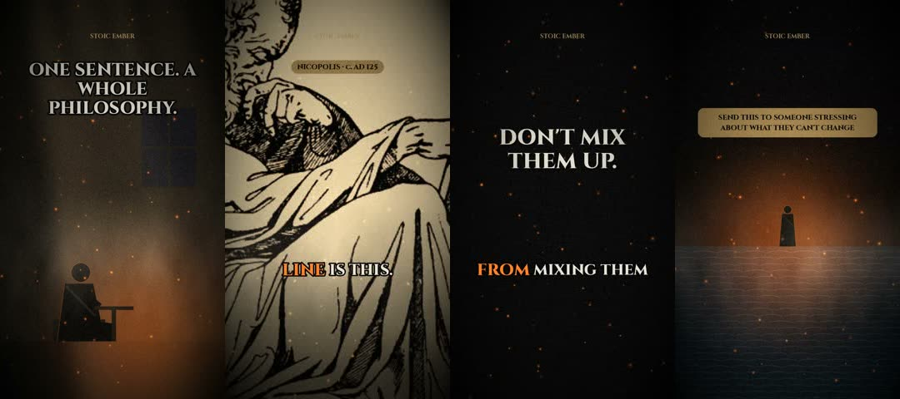
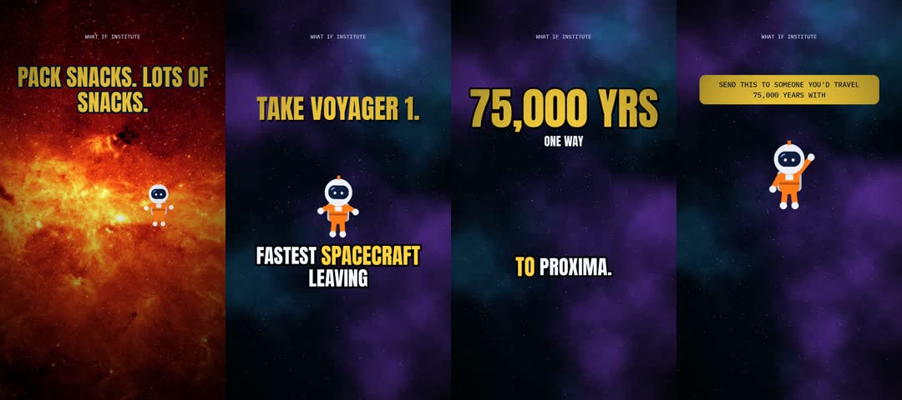

# Daily report 2026-11-22: all good

Generated 2026-11-22 15:46 UTC, after the daily publish.

## 1. Needs fixing

Nothing. Every channel published and every check passed.

## Heads-up

- **What If Institute**: only 2 episode(s) left in the queue.
- **Stoic Ember**: only 1 episode(s) left in the queue.
- **Mind Mites**: only 1 episode(s) left in the queue.
- **Facebook**: Reel insights failed for 39 video(s): `GET https://graph.facebook.com/v23.0/1118193847785244/video_insights -> 400: (#100) The value must be a valid insights metric`

## 2. Today's videos

### Mind Mites: Brain Test #16: Five heads in a row. What's next? 🪙

hook · 30 % · 60 % · ending

- 37 s
- spoken hook 39/100 "A fair coin. Heads. Heads. Heads. Heads. Heads."
- on-screen hook "Five heads in a row. Next?"
- no loop
- [YouTube](https://youtube.com/shorts/605oyf1pVso) · [Facebook](https://www.facebook.com/reel/1149929831350587) · Instagram
- To improve next time: spoken hook scores 39/100 (weak). Weakest: stakes, 0 tension marker(s) - nothing is at stake in this line.; No loop: the last line shares no word with the first, so the end does not invite a replay.

### Stoic Ember: A former slave's first lesson: only two kinds of things.

hook · 30 % · 60 % · ending

- 42 s
- spoken hook 41/100 "Most suffering comes from one mistake."
- on-screen hook "One sentence. A whole philosophy."
- no loop
- [YouTube](https://youtube.com/shorts/lhLOoaqYK6w) · [Facebook](https://www.facebook.com/reel/2297340114168673) · Instagram
- To improve next time: spoken hook scores 41/100 (weak). Weakest: specificity, 0 concrete marker(s) - no number, no name, nothing checkable.; No loop: the last line shares no word with the first, so the end does not invite a replay.; Estimated length 45s is outside the 30-45s target.

### What If Institute: What if you flew to the nearest star? ✨

hook · 30 % · 60 % · ending

- 46 s
- spoken hook 38/100 "What if you flew to the nearest star?"
- on-screen hook "Pack snacks. Lots of snacks."
- no loop
- [YouTube](https://youtube.com/shorts/OrLbx1e6gtg) · [Facebook](https://www.facebook.com/reel/1118193847785244) · Instagram
- To improve next time: title: sounds generated: "Rocket / fire / bulb / sparkle / dart emoji" (One emoji max, and not one of these five.); spoken hook scores 38/100 (weak). Weakest: specificity, 0 concrete marker(s) - no number, no name, nothing checkable.; No loop: the last line shares no word with the first, so the end does not invite a replay.

## 3. Performance

### Views gained in the last 24 h (vs 2026-11-21)

| channel | YouTube | Facebook | Instagram | YouTube subscribers |
| --- | --- | --- | --- | --- |
| What If Institute | +274 (4,855 total) | – | +130 (1,705 total) | 11 (+0) |
| Stoic Ember | +539 (2,951 total) | – | +118 (709 total) | 12 (+2) |
| Mind Mites | +289 (3,952 total) | – | +117 (1,275 total) | 3 (+0) |

### Top movers (views gained, all platforms)

| video | +views | YouTube | Facebook | Instagram |
| --- | --- | --- | --- | --- |
| stoic-ember/story-015-morning-routine | +641 | 525 | – | 116 |
| mind-mites/brain-test-015 | +383 | 266 | – | 117 |
| what-if-institute/what-if-015-mariana-trench | +357 | 228 | – | 129 |
| what-if-institute/what-if-014-hurricane-eye | +42 | 172 | – | 134 |
| mind-mites/brain-test-014 | +14 | 109 | – | 121 |

### Yesterday's uploads after their first day

| video | YouTube views | x median | % viewed | Facebook | Instagram | x median | likes+comments |
| --- | --- | --- | --- | --- | --- | --- | --- |
| Mind Mites: brain-test-015 | 266 | 2.58 |  | – | 117 | 0.97 | 4 |
| Stoic Ember: story-015-morning-routine | 525 | 5.9 |  | – | 116 | 4.3 | 17 |
| What If Institute: what-if-015-mariana-trench | 228 | 0.89 |  | – | 129 | 0.96 | 2 |

x median: views divided by that channel's median, so 2.0 means twice a normal video for the channel.

The full ranking with what the best videos have in common is in the weekly [performance report](https://github.com/krystofstudio7/shorts-studio/blob/main/reports/performance.md), every Monday.

