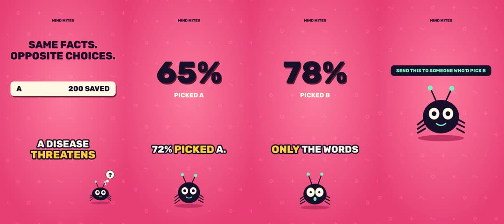
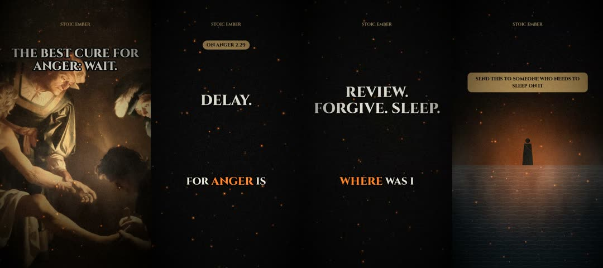
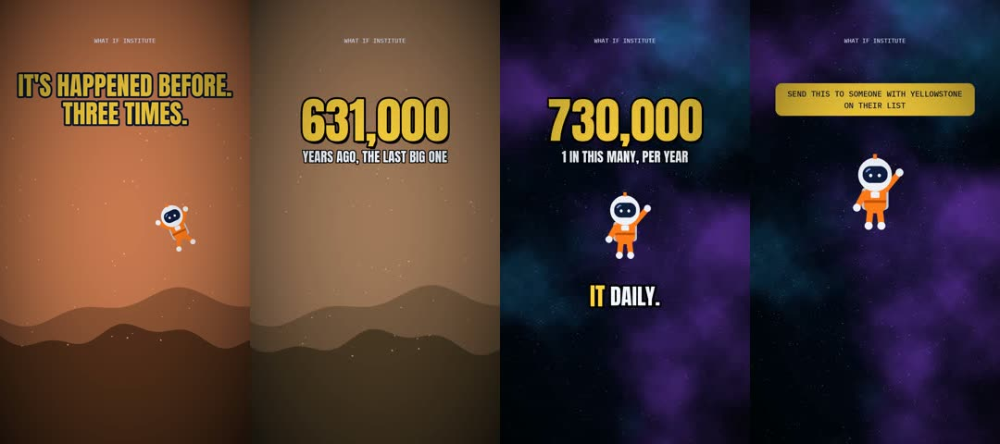

# Daily report 2026-11-23: 2 problems to fix

Generated 2026-11-23 16:11 UTC, after the daily publish.

## 1. Needs fixing

- **Stoic Ember**: the episode queue is empty, so nothing will be published tomorrow.  
  _Fix:_ The production thread needs to add episodes.
- **Mind Mites**: the episode queue is empty, so nothing will be published tomorrow.  
  _Fix:_ The production thread needs to add episodes.

## Heads-up

- **What If Institute**: only 1 episode(s) left in the queue.
- **Facebook**: Reel insights failed for 42 video(s): `GET https://graph.facebook.com/v23.0/1140144895088483/video_insights -> 400: (#100) The value must be a valid insights metric`

## 2. Today's videos

### Mind Mites: Brain Test #17: Same choice, different words 🐛

hook · 30 % · 60 % · ending

- 38 s
- spoken hook 48/100 "A disease threatens six hundred people. Plan A saves two hundred for sure."
- on-screen hook "Same facts. Opposite choices."
- no loop
- [YouTube](https://youtube.com/shorts/ZTsF8sXYgt8) · [Facebook](https://www.facebook.com/reel/1179332018372420) · Instagram
- To improve next time: spoken hook scores 48/100 (weak). Weakest: stakes, 0 tension marker(s) - nothing is at stake in this line.; The first spoken line ends at ~4.0s (13 words). Hooks that land inside 3s hold more viewers; aim for 9 words or fewer.; No loop: the last line shares no word with the first, so the end does not invite a replay.

### Stoic Ember: Seneca's cure for anger is just waiting.

hook · 30 % · 60 % · ending

- 41 s
- spoken hook 41/100 "Seneca's cure for anger costs nothing."
- on-screen hook "The best cure for anger: wait."
- no loop
- [YouTube](https://youtube.com/shorts/nwh43iYVfzA) · [Facebook](https://www.facebook.com/reel/1676741164116233) · Instagram
- To improve next time: spoken hook scores 41/100 (weak). Weakest: specificity, 0 concrete marker(s) - no number, no name, nothing checkable.; No loop: the last line shares no word with the first, so the end does not invite a replay.; Estimated length 49s is outside the 30-45s target.

### What If Institute: What if Yellowstone erupted? 🌋

hook · 30 % · 60 % · ending

- 50 s
- spoken hook 37/100 "What if Yellowstone erupted?"
- on-screen hook "It's happened before. Three times."
- loops back to the hook
- [YouTube](https://youtube.com/shorts/5CxpHqIj3jE) · [Facebook](https://www.facebook.com/reel/1140144895088483) · Instagram
- To improve next time: spoken hook scores 37/100 (weak). Weakest: stakes, 0 tension marker(s) - nothing is at stake in this line.; Estimated length 45s is outside the 30-45s target.

## 3. Performance

### Views gained in the last 24 h (vs 2026-11-22)

| channel | YouTube | Facebook | Instagram | YouTube subscribers |
| --- | --- | --- | --- | --- |
| What If Institute | +296 (5,151 total) | – | +3 (1,708 total) | 11 (+0) |
| Stoic Ember | +593 (3,544 total) | – | +48 (757 total) | 12 (+0) |
| Mind Mites | +984 (4,936 total) | – | +111 (1,386 total) | 3 (+0) |

### Top movers (views gained, all platforms)

| video | +views | YouTube | Facebook | Instagram |
| --- | --- | --- | --- | --- |
| mind-mites/brain-test-016 | +611 | 501 | – | 111 |
| stoic-ember/story-016-in-our-control | +577 | 529 | – | 48 |
| mind-mites/brain-test-015 | +499 | 765 | – | 117 |
| what-if-institute/what-if-016-nearest-star | +260 | 258 | – | 3 |
| stoic-ember/story-015-morning-routine | +62 | 587 | – | 116 |

### Yesterday's uploads after their first day

| video | YouTube views | x median | % viewed | Facebook | Instagram | x median | likes+comments |
| --- | --- | --- | --- | --- | --- | --- | --- |
| Mind Mites: brain-test-016 | 501 | 4.6 |  | – | 111 | 0.92 | 3 |
| Stoic Ember: story-016-in-our-control | 529 | 5.69 |  | – | 48 | 1.28 | 20 |
| What If Institute: what-if-016-nearest-star | 258 | 0.97 |  | – | 3 | 0.02 | 6 |

x median: views divided by that channel's median, so 2.0 means twice a normal video for the channel.

The full ranking with what the best videos have in common is in the weekly [performance report](https://github.com/krystofstudio7/shorts-studio/blob/main/reports/performance.md), every Monday.

