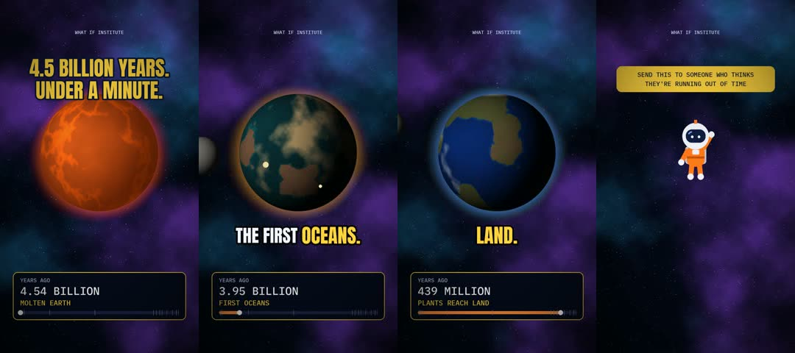

# Daily report 2026-11-24: 5 problems to fix

Generated 2026-11-24 16:02 UTC, after the daily publish.

## 1. Needs fixing

- **Stoic Ember**: nothing was published today.  
  _Fix:_ Check the Render videos run below; if the queue is empty, the production thread needs to add episodes.
- **Mind Mites**: nothing was published today.  
  _Fix:_ Check the Render videos run below; if the queue is empty, the production thread needs to add episodes.
- **What If Institute**: the episode queue is empty, so nothing will be published tomorrow.  
  _Fix:_ The production thread needs to add episodes.
- **Stoic Ember**: the episode queue is empty, so nothing will be published tomorrow.  
  _Fix:_ The production thread needs to add episodes.
- **Mind Mites**: the episode queue is empty, so nothing will be published tomorrow.  
  _Fix:_ The production thread needs to add episodes.

## Heads-up

- **Facebook**: Reel insights failed for 43 video(s): `GET https://graph.facebook.com/v23.0/1587820013374348/video_insights -> 400: (#100) The value must be a valid insights metric`

## 2. Today's videos

### What If Institute: Watch Earth being built, from lava to today 🌍

hook · 30 % · 60 % · ending

- 47 s
- spoken hook 51/100 "4.5 billion years of Earth, in under a minute."
- on-screen hook "4.5 billion years. Under a minute."
- no loop
- [YouTube](https://youtube.com/shorts/R9z_-7CZEvE) · [Facebook](https://www.facebook.com/reel/1587820013374348) · Instagram
- To improve next time: The first spoken line ends at ~3.4s (10 words). Hooks that land inside 3s hold more viewers; aim for 8 words or fewer.; No loop: the last line shares no word with the first, so the end does not invite a replay.

## 3. Performance

### Views gained in the last 24 h (vs 2026-11-23)

| channel | YouTube | Facebook | Instagram | YouTube subscribers |
| --- | --- | --- | --- | --- |
| What If Institute | +94 (5,245 total) | – | +74 (1,782 total) | 11 (+0) |
| Stoic Ember | +229 (3,773 total) | – | +7 (764 total) | 12 (+0) |
| Mind Mites | +911 (5,847 total) | – | +139 (1,525 total) | 4 (+1) |

### Top movers (views gained, all platforms)

| video | +views | YouTube | Facebook | Instagram |
| --- | --- | --- | --- | --- |
| mind-mites/brain-test-017 | +644 | 505 | – | 139 |
| mind-mites/brain-test-016 | +403 | 904 | – | 111 |
| what-if-institute/what-if-017-yellowstone | +158 | 84 | – | 74 |
| stoic-ember/story-016-in-our-control | +136 | 665 | – | 48 |
| stoic-ember/story-017-anger-delay | +90 | 85 | – | 5 |

### Yesterday's uploads after their first day

| video | YouTube views | x median | % viewed | Facebook | Instagram | x median | likes+comments |
| --- | --- | --- | --- | --- | --- | --- | --- |
| Mind Mites: brain-test-017 | 505 | 4.11 |  | – | 139 | 1.12 | 6 |
| Stoic Ember: story-017-anger-delay | 85 | 0.91 |  | – | 5 | 0.13 | 5 |
| What If Institute: what-if-017-yellowstone | 84 | 0.31 |  | – | 74 | 0.56 | 4 |

x median: views divided by that channel's median, so 2.0 means twice a normal video for the channel.

The full ranking with what the best videos have in common is in the weekly [performance report](../../performance.md), every Monday.

